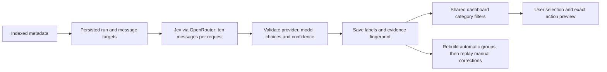

# Jev classification

User-authorized scope change, 2026-10-29: optional hosted classification through
OpenRouter is now allowed. This supersedes the earlier non-AI restriction only
for classification and sender organization. It does not authorize automatic
mailbox actions, body/snippet downloads, drafting, or cross-address identity inference.

## Setup and use

Add `OPENROUTER_API_KEY=your-key` to the existing local `.env` (already ignored by
Git), rebuild/restart TidyMail, then choose **Classify mail** and start a run.
A missing key disables starting runs without affecting normal cleanup. The key
is deployment-wide; use a dedicated OpenRouter key with a spending limit.
Do not put it in browser JavaScript, screenshots, tracked configuration or chat.

In OpenRouter's account settings, disable private Input & Output Logging,
OpenRouter Use of Inputs/Outputs (the sharing discount), Broadcast and external
observability destinations. Enable ZDR for **All other models**. These settings
are account-owned: the application cannot inspect or change them. They matter
even when requests require a zero-retention inference provider.

The classifier pins `typesafe/jev-1.14` and provider `typesafe`, with
`provider.zdr=true`, `provider.data_collection=deny`,
`provider.allow_fallbacks=false`, and `X-OpenRouter-Cache: false`. It never uses
an alternate model/provider when that route is unavailable. HTTP redirects are
disabled so a redirect cannot forward credentials elsewhere. No tools, plugins,
trace/session/user identifiers or arbitrary external URLs are submitted.
OpenRouter retains usage metadata and documents legal/CSAM screening exceptions;
ZDR is a published policy, not a claim that no processing or logging ever occurs.

Sources verified 2026-10-29:
[Decisions API](https://openrouter.ai/docs/api/api-reference/alphadecisions/submit-a-decisions-request),
[Jev](https://openrouter.ai/docs/guides/community/jev),
[ZDR](https://openrouter.ai/docs/guides/features/zdr),
[data collection](https://openrouter.ai/docs/guides/privacy/data-collection),
[response cache controls](https://openrouter.ai/docs/guides/features/response-caching).
No live key or private mailbox data was required to build the integration.

## What is classified

An explicit run snapshots existing eligible received-message IDs across Inbox and
archived mail, excluding Spam, Trash, drafts, sent-only mail, unknown label
eligibility, and ambiguous From identities. It ignores dashboard search/date/category
filters, and the dialog states that scope. It normally sends ten messages per
request, each with the exact parsed sender address, sender display name (120
characters), subject (300 characters), five standard Gmail category hints,
boolean mailing-list/unsubscribe evidence and boolean References/In-Reply-To
evidence. Internal message/account IDs, recipients, custom labels, OAuth tokens,
bodies, snippets and attachments are not sent. Reply-header evidence does not
prove that the account owner has replied to or knows the sender.

Each email gets three independent, fixed-choice questions:

| Dimension | Stored values |
|---|---|
| Message purpose | PERSONAL, MARKETING, NEWSLETTER, RECEIPT, SECURITY, NOTIFICATION, OTHER, UNCERTAIN |
| Sender kind | PERSON, AUTOMATED, RELAY, UNKNOWN |
| Service stream | GENERAL, VOICE, AI_PRODUCT, DEVICE_SUPPORT, SECURITY, BANKING, SHOPPING, TRAVEL, SOCIAL, WORK |

Categories have stable application IDs. Jev selects them; it cannot create a
category named after a person or invent spelling variants. Different display
names or addresses never implicitly merge personal identities.

For the three-message example:

| Message | Sender identity | Possible category |
|---|---|---|
| Shivani at gene.com | Exact work address | PERSONAL |
| Amazon | Exact address within an optional automated Amazon group | RECEIPT or MARKETING, depending on this message's metadata |
| Shivani at gmail.com | Exact Gmail address, independent of the work address | PERSONAL |

`shivani.tewari20166@gmail.com` is another independent address. A shared name,
nearby spelling, or matching category is not identity evidence. A user can still
explicitly merge or separate groups using the existing correction flow.

## Architecture

Remote I/O runs outside database transactions and independently of cleanup/sync.
Each dispatched request has a durable attempt UUID. A separate deployment-wide
ledger records each returned decimal cost once, including rejected decisions,
stale results and cancelled work. Historical job costs remain separate from the
new allowance. Each $1 of newly reported spend pauses dispatch; existing requests
may finish and overshoot. Keep the external key cap as the hard spending control.

**Continue for another $1** grants a new allowance from the settled reported
total. Its generation token makes repeated clicks idempotent. Only the allowance
owner (the earliest retained account, or first dispatch on an empty deployment)
can continue shared spending. Other mailboxes share the same allowance. Timeouts,
crashes and missing/invalid billing data pause paid work for explicit OpenRouter
activity review and acknowledgement. Unknown charges are not counted as free.
Known-cost retryable provider failures retain the bounded 30-second retry policy.

Saved categories remain browsable in all states. Automatic regrouping happens
after 500 saved messages, at a spending checkpoint, or at completion; consistent
fresh sender-kind/stream evidence is required and manual grouping is replayed.
Ordinary category saves increment a separate classification revision. Unfiltered
drafts survive batches; category-filtered drafts and previews detect changed
category evidence, and meaningful grouping changes still invalidate drafts.
Confirmed cleanup targets remain fixed.

Incoming/changed metadata is queued transactionally by an outbox trigger. The
worker processes it after commit without blocking sync. Automatic processing is
on by default when Jev is configured, with a visible switch. It reuses valid
results, skips explicit category overrides, shares the allowance, prioritizes
arrivals and reserves a batch slot for manual historical catch-up. Disabling it
preserves queued work and manual runs. Cancellation and terminal failure suspend
automatic replay of those entries until an explicit retry/toggle or new evidence.
A manual catch-up can extend an active automatic run without duplicate targets.

Select **Unclassified** to find remaining evidence. Click an address in either
sender surface to open its exact messages, preserving category/search/date/scope
filters and resetting pagination. **All messages in this group** removes that
address restriction. Checkboxes retain independent selection. Individual groups
show stored From names with exact addresses; these names are not Gmail contact
enrichment. Manual labels and organization/service labels remain authoritative.
Message rows distinguish Jev from manual corrections; corrections record account
and time without adding rule tables or automatic rule learning.

The opt-in `--app.classification.benchmark.enabled=true` runner pauses ordinary
paid dispatch, compares baseline, compact instructions, batch 10, parallel 2 and a
combined candidate under the same ledger, then measures a bounded storage sample.
It never continues spending automatically. Aggregate results are written to
`docs/CLASSIFICATION-BENCHMARK.md`; no retained message contents or credentials
are written there. Experimental prompts never overwrite existing classifications.
Production retains the original three dimensions and semantic version. Normal
parallel dispatch remains disabled; experimental attempts have separate durable
claims. `app.classification.batch-size` controls transport size (2–20; deployment default 10).
See the benchmark report for the measured choice and limits.

Results are matched to message IDs locally. A fingerprint covers exactly the
bounded metadata and normalized hints used by this classifier version; a trigger
refreshes it on metadata writes. Changed inputs are skipped if they change in
flight, and display as Unclassified rather than reusing stale categories. The automatic outbox handles new or changed messages after commit; explicit catch-up handles historical backlog. The pinned model and question-set
version are also part of cache validity. No automatic mailbox-wide reprocessing
runs just because the key is configured. Manual per-message category overrides
survive new classification and can be reset separately.

Both reported confidence and the chosen option's probability must reach 0.85.
Otherwise purpose becomes UNCERTAIN, kind UNKNOWN, or stream GENERAL. This is an
initial conservative operating threshold, not a measured 85% accuracy guarantee.
Malformed distributions, unknown values, unexpected provider/model and incomplete
responses are rejected; raw remote bodies and exceptions are never shown/logged.
Only normalized labels, conservative confidence, model/version, timestamp,
fingerprint, run counts and provider-reported cost are retained locally.

At bounded regrouping checkpoints, ADDRESS units can group by registrable domain plus
service stream only when all their messages have fresh, confident, consistently
automated classifications. People, relays, mixed/uncertain senders and shared
provider domains retain exact addresses. Google Voice encoded addresses are
explicitly excluded from organization merging even if the model guesses wrong.
LIST boundaries remain intact. Saved manual grouping events are replayed over
the new baseline; a conflict rolls back that grouping transaction instead of
dropping a correction. Confirmed cleanup targets never change. Meaningful grouping changes invalidate drafts and unconfirmed previews; category progress affects category-filtered drafts and previews.

All dashboard counts, paging, address expansion, selection and action eligibility
use the same category predicate. A category can therefore isolate Amazon offers
without including its receipts. Categories never choose or execute cleanup actions.

## Accuracy and limitations

Metadata alone cannot reliably distinguish every receipt, promotion, work message
or personal conversation. Missing metadata, misleading display names, mixed-purpose
senders, forwarded mail, unsupported languages and new services can produce errors.
Gmail's categories are hints rather than truth. Incoming email fields are untrusted;
question instructions explicitly prohibit obeying embedded instructions. This
reduces instruction injection risk but is not a model accuracy guarantee.

The next meaningful evaluation is a small user-labeled, representative sample:
people's work/personal addresses, Chase variants, Google service streams, receipts,
promotions, newsletters and uncertain cases. Compare false merges and wrong
categories for both accepted and abstained decisions before lowering thresholds.
Prefer saved corrections and improvements to the shared question set over lists
of special rules for individual people. Richer content, contact access, historical
reply analysis or body/snippet processing requires a separate scope decision.

## Initial integration validation — historical, before this improvement rollout

The Java 21 package build passed with 72 focused tests (zero failures/errors/skips)
covering classification, identity, dashboard journeys, V15/V17/V19 upgrades,
cleanup jobs, resilience and performance. Classified-category browsing passed at
10k/50k messages (p95 41.86/101.59 ms in this run); ordinary browsing also passed
with concurrent metadata writes and cleanup. JavaScript syntax and diff checks passed.

The isolated desktop fixture classified 364 synthetic messages with simulated Jev
responses. UI checks covered start/progress across reload, completion, work/Gmail
addresses staying separate under Personal, Amazon Marketing excluding receipts,
and a selected-message category override. These verify application behavior, not
Jev's real-world categorization accuracy. No live Jev call, retained-database
migration, running-app restart, commit, push or deployment was performed here.
A representative user-labeled live sample remains the next accuracy check after
local key and account privacy settings are configured. The full test suite was
not run.

## Improvement rollout — 2026-10-30

The approved V21→V23 upgrade and benchmark runs are complete. See
[implementation and validation](CLASSIFICATION-IMPLEMENTATION.md) and the
[real-model benchmark](CLASSIFICATION-BENCHMARK.md). The original 59,120 saved
classifications still match the verified backup exactly; 80 newly eligible
messages were saved across two bounded end-to-end checks. Newly reported spend
was $0.01580061 across both experiment rounds, with generation 0 and the original
$1 checkpoint intact. Automatic incoming processing is enabled. Real-mail
classification accuracy remains subject to metadata limitations and a broader
user-labeled evaluation; the benchmark's labeled quality cases are synthetic.
