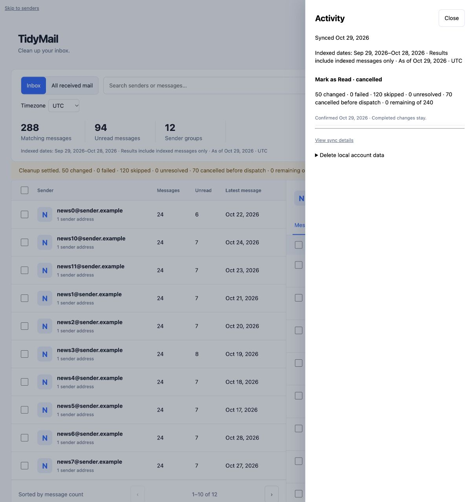
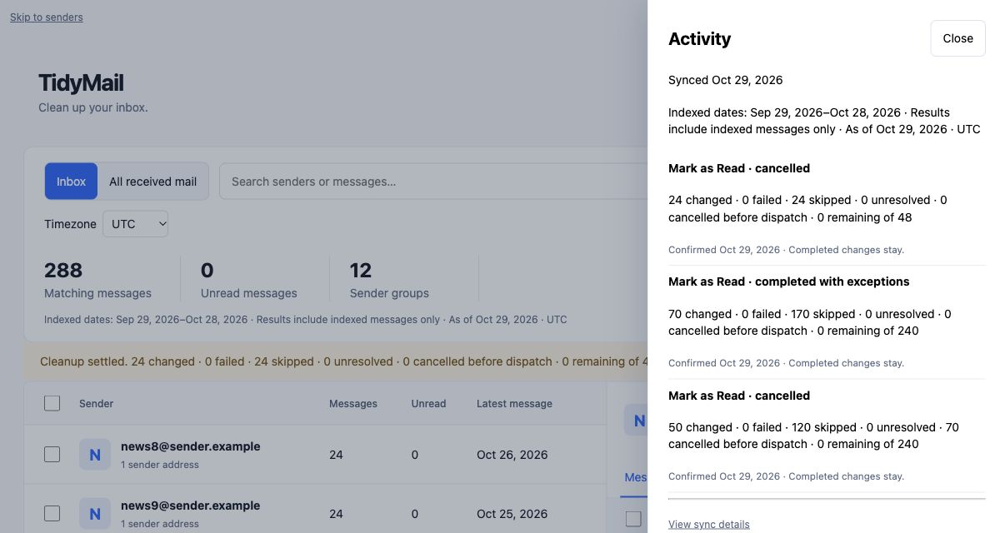

# Phase 4 — durable background Mark as Read

Scope: the approved desktop dashboard, one action (Gmail Mark as Read), exact
confirmation, durable progress, cancellation and conservative restart recovery.
Implementation and validation use synthetic accounts and simulated Gmail. The
retained application/database and real mailbox have not been changed or restarted.
No commit, push or deployment is included.

## Delivery and acceptance

| Task | Status | Dependency | Deliverable / evidence |
|---|---|---|---|
| Persist fixed confirmation and targets | Complete | Phase 3 exact preview | V17 job/target/batch/claim/event tables, preview token idempotency, account lock, scope integrity and overlap rejection |
| Dispatch bounded Mark as Read work | Complete | Persisted job | Dedicated background executor, 50-target batches, provider reads outside transactions, current filter/protection recheck |
| Cancel queued and active work | Complete | Shared dispatch lock | Persistent request; unclaimed targets cancelled immediately; claimed requests settle; no mutation retry or replay |
| Reconcile uncertain outcomes and recover leases | Complete | Per-target dispatch evidence | Five-minute generation-fenced leases; expired intents become unresolved; subsequent work only verifies labels for those targets |
| Show progress and restore results | Complete | Durable state | Bottom dock, Cancel, Activity history, polling after reload, exact outcome counts and desktop focus restoration |
| Validate isolated upgrade | Complete | Additive V17 migration | Fresh install and 10k-message retained fixture; V16 previews mapped or safely invalidated if metadata disappeared |
| Validate provider request | Complete | Gmail adapter | Real Gmail SDK against loopback HTTP, exact IDs/remove-UNREAD, success/401/503 with one attempt even when initializer permits retries |
| Validate dashboard journey | Complete | Above | 501 targets in 11 bounded batches; duplicate submit, cancellation races, read failure, ambiguous send, recovery, ownership/CSRF and deletion barrier |
| Validate desktop browser | Complete | Synthetic authenticated fixture | Confirmation, reload during work, cancellation, completion, dashboard reconciliation, Activity history and keyboard focus; screenshots below |
| Full regression run | Complete, baseline failures remain | Phase 4 implementation | 481 tests: 479 passed, two known baseline assertions failed, zero errors/skips; bounded final refinements verified separately |

## State and accounting

Phase 4 is complete for simulated-provider and desktop acceptance. Phase 5 remains
not started; live and release acceptance remain open.

The preview UUID is the confirmation token. Confirmation checks its account,
expiry, invalidation, grouping revision, action, exact scope and fixed target
membership. Repeating a successful token returns the original job even after
cancellation or expiry. Another preview cannot claim targets already active or
unresolved. New arrivals never enter confirmed jobs. Known no-ops/protected
messages remain in the fixed total as skipped targets.

The six buckets are calculated from target rows in one database snapshot:

`changed + failed + skipped + unresolved + cancelled before dispatch + remaining = selected total`.

Job and target identities have database update guards. Target outcomes are not
independent mutable counters. Events retain count/status snapshots without
provider IDs, addresses or subjects. Responses expose counts and public job IDs.

A worker claims a short persisted lease, reads current metadata outside the
transaction, then takes the job lock again to recheck cancellation and current
indexed filter/protection eligibility. It commits an immutable dispatch intent
before making one provider mutation attempt. A cancellation taking that lock
first prevents new intent. An earlier intent is already claimed and may finish
after the click, including across the unavoidable commit-to-network gap.

Only observed read labels after a pre-dispatch unread observation count as
changed; an HTTP success response alone does not. Read state is observation
evidence, not proof that no other mail client participated. Missing/invalid
post-dispatch observations, exceptions and still-unread messages remain
unresolved. Lost dispatch leases are never put back into the mutation queue.
Late workers cannot write after a new lease generation. Read-only verification
continues after cancellation and updates the final changed count.

Local read-state reconciliation advances the observed message history revision
and rejects observations older than current indexed revisions. Existing sync
upserts then reject earlier metadata snapshots. It preserves other local labels.
Deleting local data first requests cancellation and returns a conflict while
requests or verification workers hold leases; normal sign-out retains
work and indexed data. Explicit deletion can discard unresolved history once active
leases and dispatch intents settle; unresolved outcomes alone do not indefinitely
block the owner from removing local data.

## Automated evidence

The first focused run passed 23 tests (Java selected by Maven was 27). The next
explicit Java 21 run passed 28 tests across `DashboardJobJourneyTest`,
`DashboardGmailDispatchTest`, `DashboardJourneyTest`, `DashboardMigrationTest`,
`Phase15PostgresMigrationTest` and `LogoutSemanticsTest`. A first attempt at that
run was interrupted because the new standalone provider test had zero semaphore
capacity; the fixture was corrected to configure capacity explicitly.

The Java 21 full suite ran 481 tests: 479 passed, two failed, zero errors/skips.
The failures are the existing `MailboxFreshnessJourneyTest.newUserSeesFirstBatchBeforeFullMailboxBackfillCompletes`
sender-label assertion and `Phase8DeploymentTest.T8d_lintAndDocTests.T8d_01_deployMdChecks`
deployment-command assertion. They are unchanged baseline gaps; this is not a
clean release gate. The additional stale-read/sync-fencing case and stronger
V16-preview upgrade fixture passed in that run.

After the full run, bounded refinements aligned archived received/Sent delivery
checks with the browsing contract and allowed explicit local-data deletion once
active leases settle, even if unresolved history remains. The final Java 21 focused run passed all 30 tests with zero failures, errors or
skips. It includes 15 dashboard-job journeys, three on-wire Gmail dispatch checks,
eight browsing journeys, two migration fixtures and two logout checks.

```sh
JAVA_HOME=/opt/homebrew/opt/openjdk@21/libexec/openjdk.jdk/Contents/Home \
DOCKER_HOST=unix:///Users/srt/.colima/default/docker.sock \
TESTCONTAINERS_DOCKER_SOCKET_OVERRIDE=/var/run/docker.sock \
mvn -o -Dtest='DashboardJobJourneyTest,DashboardGmailDispatchTest,DashboardJourneyTest,DashboardMigrationTest,Phase15PostgresMigrationTest,LogoutSemanticsTest' test
```

These are isolated PostgreSQL and simulated-provider checks, not measured live
Gmail throughput. Worker restart is exercised through persisted expired leases
and replacement generations; no production JVM was stopped.

## Desktop browser evidence

The explicit `DashboardBrowserFixture` serves actual Thymeleaf/MockMvc routes,
CSRF and an authenticated synthetic account over loopback. Its provider is mocked;
a separate test timer invokes the same background worker tick. No real OAuth
account is involved. The initial browser-tool connection stalled until the
15-minute fixture expired; a fresh fixture was then used successfully.

| Journey | Observed result |
|---|---|
| Current page selection and review | 240 fixed IDs, 120 eligible, 120 known no-ops, exact targets paged in modal |
| Confirm and reload | Queued/running progress and Cancel restored from saved job; selection cleared |
| Cancel remaining work | 50 changed + 120 skipped + 70 cancelled = 240, zero remaining/unresolved; unread count 144 → 94 |
| Complete a subsequent job | 70 changed + 170 skipped = 240; saved history restored after reload |
| Keyboard cancel during a claimed request | Initially 24 remaining with cancellation pending; settled at 24 changed + 24 skipped = 48, zero remaining; the already-claimed request completed after Cancel |
| Final dashboard and focus | Unread count 0; empty dock hidden; Escape from Activity restores its opener; confirmation restores the sender table after draft selection clears; no browser console errors |

The browser pass found a focus loss after confirmation and unnecessary focus
loss during polling. Confirmation now focuses the sender table when selection
clears; unchanged job snapshots do not rebuild controls, and changed progress
preserves a focused Cancel control or moves focus to Activity/Close when it ends.
No mobile/narrow-screen acceptance was performed.





## Boundaries and next phase

Archive and Move to Trash remain preview-only on the dashboard. The server
rejects confirming those actions. Legacy cleanup/Undo routes remain until the
separate Phase 6 simplification; they do not participate in the new job claims.
Avoid mixing legacy and dashboard mutations against the same live messages until
that gate is closed.

Provider mutation attempts are not retried. Current definitive-looking HTTP
failures are conservatively reconciled rather than advertised as per-target
failures; unread targets stay unresolved and retain overlap claims. Read failures
before dispatch leave work queued with a persisted ten-second delay and can be
cancelled immediately. Bounded reconnect/backoff/exhaustion policy, coordinated
capacity, richer per-target error handling and Archive/Trash belong to Phase 5.
There is no new pause, resume, Undo or permanent deletion path.

Google documents an empty success body and a maximum of 1,000 IDs for
[users.messages.batchModify](https://developers.google.com/workspace/gmail/api/reference/rest/v1/users.messages/batchModify).
This implementation chooses 50 as a conservative local batch size and verifies
labels separately; it does not infer per-target success from that empty body.

The retained development database must still follow the backup/upgrade procedure
in the [Phase 2 report](PHASE-2-BASELINE-AND-PERSISTENCE.md) before it is upgraded.
Small and larger live-mail acceptance, release readiness and publication remain
separate gates. Phase 5 has not started.
