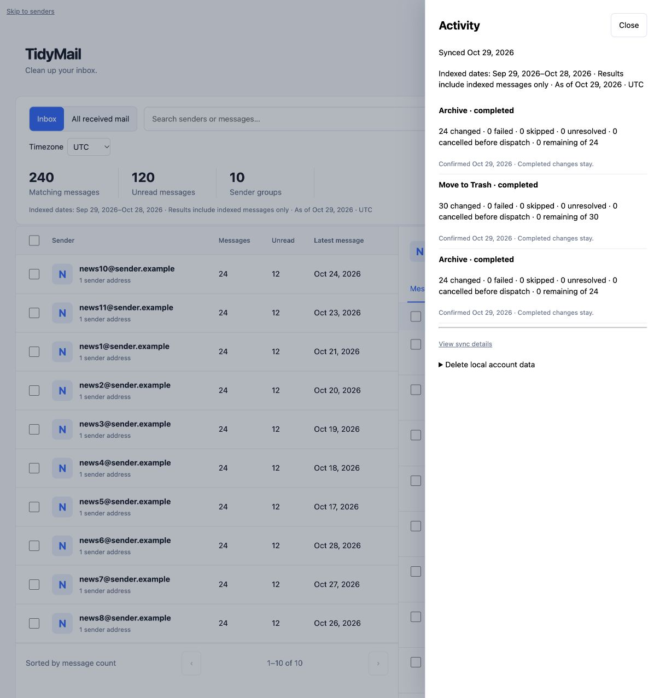
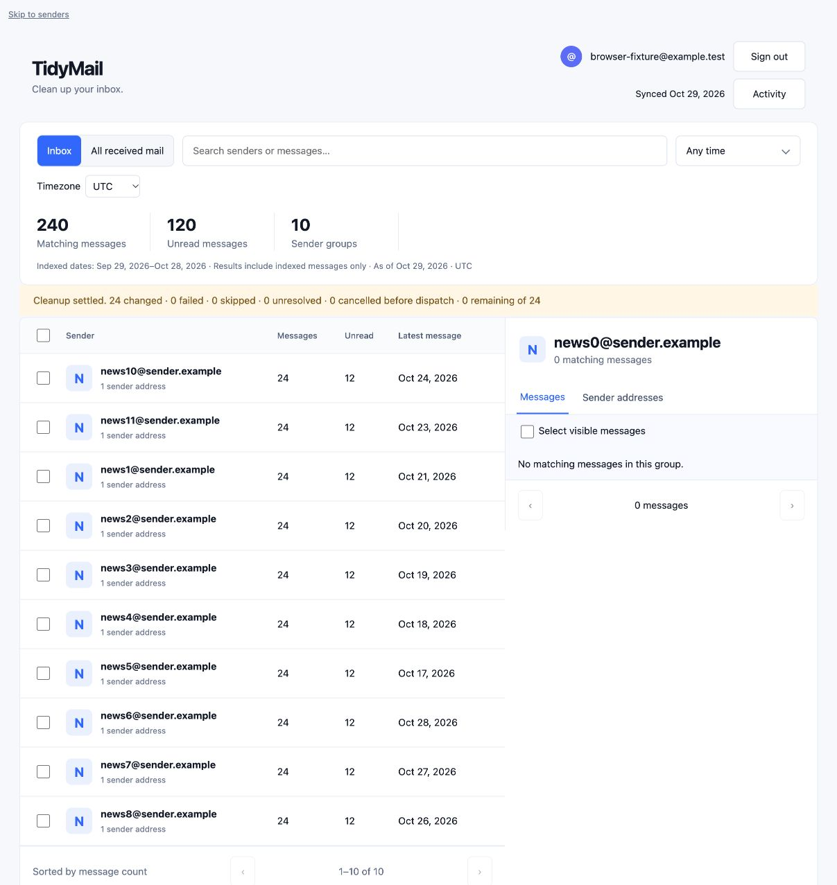

# Phase 5 — actions and resilience

Implementation date: 2026-10-29. Scope: desktop dashboard Gmail Mark as Read,
Archive and Move to Trash, with durable jobs and conservative provider recovery.
Validation uses synthetic accounts, isolated PostgreSQL, and simulated Gmail.
The retained development application/database and real mailbox are untouched.

## Delivery and acceptance

| Task | Status | Dependency | Deliverable / evidence |
|---|---|---|---|
| Extend confirmed jobs to Archive and Trash | Complete | Phase 4 durable execution | Fixed action and targets, idempotent confirmation, 50-target dispatch and account ownership guards |
| Reconcile labels and counts | Complete | Confirmed provider observations | Archive removes INBOX, Trash adds TRASH and excludes both scopes, other labels/read state preserved; sync revision fencing retained |
| Coordinate provider capacity | Complete | Existing Gmail limiter | Cleanup mutations and verification share backfill/rescan capacity; reserved freshness capacity remains available; metadata uses paced ten-request batches |
| Persist bounded read retries | Complete | V18 migration | Six attempts per queued target or unresolved outcome, exponential delays plus jitter, Retry-After, reconnect guidance and no sleeping retry worker |
| Recover and cancel safely | Complete | Phase 4 leases and intent locks | Five-minute generation-fenced leases, read-only recovery of lost intents, cancelled queued work never dispatched, in-flight outcomes settle |
| Verify synthetic resilience | Complete | Above | Final Java 21 focused run: 87 passed; 24 action/scenario combinations with 501 targets each; full suite: 513 passed, two known baseline failures |
| Verify desktop behavior | Complete | Synthetic authenticated browser fixture | Archive/Trash confirmation, reload restoration, Activity action names, scope/count reconciliation, last-page contraction; no console errors |

## Execution and accounting

All actions use the same immutable preview, job, target, batch and cancellation
contracts as Phase 4. V18 broadens the allowed action types and adds persisted
read/verification attempt counts, sanitized retry guidance and a generic observed
precondition. It copies the old Mark as Read precondition so retained dispatch
intents can still be attributed when labels are verified after upgrade. Credentials,
metadata, cursors, prior target identities and history are not reset.

Before dispatch the worker rechecks indexed filters/protection and current provider
labels. Archive requires Inbox membership; Mark as Read requires unread state;
Trash requires received-mail eligibility outside Spam/Trash/Drafts. Already-achieved
states are skipped. Dispatch intent is committed under the same lock as Cancel.
Provider calls remain outside database transactions. The existing token manager
continues to refresh/coalesce credentials; reconnect-required failures surface a
Gmail reconnect link through Activity.

Success requires observing the requested label state after observing its
precondition. Empty HTTP success bodies alone never count as changed. Explicit
400/401/403/404/429 mutation rejections produce failed outcomes unless subsequent
labels confirm the requested state. Transport errors and server failures remain
unresolved and receive only bounded read-only verification. No mutation is
replayed automatically, including after a timeout, throttling, restart or reconnect.
The user may review a fresh exact selection for failed targets later; unresolved
ones retain overlap protection.

Read waits are persisted in next_attempt_at, with exponential backoff up to 64
seconds plus 0–250 ms jitter. Retry-After can extend that delay. Credential failures
wait at least a minute and show reconnect guidance. Six unsuccessful pre-dispatch
reads fail the affected queued targets; six unsuccessful verification observations
retain unresolved outcomes and stop automatic verification. No success or unchanged
state is guessed. Cancel immediately removes queued work even during a long wait;
already-claimed requests may finish. Verification continues within its bounded
budget without re-enabling mutations. Unresolved work stays visibly unresolved.

The target-row invariant remains:

`changed + failed + skipped + unresolved + cancelled before dispatch + remaining = fixed total`.

Reconciliation changes only the action's label/read delta, preserving unrelated
labels and blocking older provider revisions from overwriting newer local state.
Archived received messages remain in All received mail. Trash disappears from both
scopes. Expanded address counts refresh, message details refresh, and a sender page
that disappears after cleanup falls back to the last valid page.

## Provider documentation and choices

Checked Google's current official documentation while implementing this phase:
[batchModify](https://developers.google.com/workspace/gmail/api/reference/rest/v1/users.messages/batchModify)
accepts exact IDs and label additions/removals, permits up to 1,000 IDs, and returns
an empty success body. TidyMail keeps its smaller 50-target mutation batches.
[HTTP batching guidance](https://developers.google.com/workspace/gmail/api/guides/batch)
recommends no more than 50 subrequests; metadata batches remain ten requests,
sharing the existing pacing budget with sync. These are different batch limits.
[Error handling](https://developers.google.com/workspace/gmail/api/guides/handle-errors)
documents authentication, quota and server failures, backoff and Retry-After.

Cleanup reads make one HTTP attempt per metadata batch; retry scheduling belongs
to the durable queue. Sync keeps its existing successful-ID-preserving read retries.
Cleanup uses five-second connection and fifteen-second read timeouts, leaving
headroom inside its five-minute lease. Lease loss still fences late writes and
causes verification rather than replay. The one-attempt mutation path disables SDK
transport retries even if a client initializer enables them.

## Automated evidence

The first focused run executed 49 tests: 43 passed and six errored in test setup
because Mockito re-stubbing invoked a previously configured throwing mock. The
fixture was corrected to replace its response without invoking it. There were no
assertion failures in that run. The next expanded Java 21 run passed all 83 tests,
with zero failures/errors/skips, including 21 action/scenario combinations using
501 fixed targets each, on-wire request checks, sync recovery and capacity tests.

The Java 21 full suite then ran 515 tests: 513 passed, two failed, zero errors or
skips. The failures are the existing
`MailboxFreshnessJourneyTest.newUserSeesFirstBatchBeforeFullMailboxBackfillCompletes`
sender-label assertion and
`Phase8DeploymentTest.T8d_lintAndDocTests.T8d_01_deployMdChecks`
deployment-command assertion. Both were recorded in Phase 4. This is not a clean
release gate.

After that run, review found that errors while reading labels immediately after
dispatch could lose provider retry guidance. The worker now preserves those errors
separately from mutation rejection, respects the longest applicable Retry-After,
and keeps authentication failures during verification unresolved. The final focused
run passed all 87 tests with zero failures/errors/skips, including 24 action/scenario
combinations of 501 targets each, the V17 in-flight upgrade fixture and the real
credential-manager reconnect signal. The full suite was not repeated after this
bounded refinement. JavaScript syntax and `git diff --check` also passed.

Phase 5 is complete within its synthetic-provider and desktop scope. Phase 6 is
next; live mailbox and release acceptance remain open.

```sh
JAVA_HOME=/opt/homebrew/opt/openjdk@21/libexec/openjdk.jdk/Contents/Home \
DOCKER_HOST=unix:///Users/srt/.colima/default/docker.sock \
TESTCONTAINERS_DOCKER_SOCKET_OVERRIDE=/var/run/docker.sock \
mvn -o -Dtest='DashboardResilienceTest,DashboardJobJourneyTest,DashboardGmailDispatchTest,DashboardJourneyTest,DashboardMigrationTest,Phase15PostgresMigrationTest,LogoutSemanticsTest,GmailSynchronizationContractTest,GmailBackfillRecoveryJourneyTest' test
```

## Desktop browser evidence

The authenticated `DashboardBrowserFixture` uses actual Thymeleaf/MockMvc routes,
CSRF, temporary PostgreSQL and a mocked provider. No real account is involved.

| Journey | Observed result |
|---|---|
| Archive, then reload during work | 24 fixed targets restored as queued; Activity later reported 24 changed and zero remaining/unresolved |
| Browse All received mail afterward | All 360 received messages remained, including the 24 just archived |
| Trash an archived sender from All received | 30 fixed targets; Activity reported 30 changed with zero remaining/unresolved |
| Reconcile both scopes | All received fell 360 → 330, unread 180 → 165; Inbox showed 264 messages and 132 unread after the first Archive/Trash pair |
| Empty the last sender page with Archive | 24 further changes; sender pager moved 11–11 of 11 → 1–10 of 10; Inbox ended at 240 messages, 120 unread |
| Reload completed history | All three jobs restored with correct Archive/Move to Trash names and totals; no browser console errors |





## Boundaries and next phase

These are simulated-provider results, not live Gmail throughput or acceptance.
Worker restart is represented by expired persisted leases and replacement
workers; no retained JVM was restarted. No mobile acceptance was performed.
Legacy cleanup/Undo routes remain for the Phase 6 simplification gate. Keep those
separate from dashboard actions against the same live targets until that gate
closes. Richer pending-row feedback and the remaining desktop simplification also
belong to Phase 6.

The retained database still requires the Phase 2 backup/upgrade procedure.
Small and larger user-selected live checks remain Phase 7. No commit, push,
deployment or publication is included.
