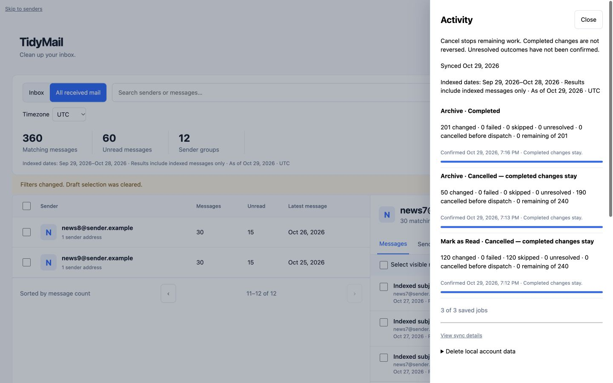

# Phase 6 — complete the simplified experience

Implemented and verified 2026-10-29. Phase 6 is complete for the desktop MVP.
All new verification used synthetic accounts, temporary PostgreSQL databases,
and a simulated Gmail provider. This work did not restart the retained app,
upgrade its database, or select/change real Gmail messages.

## Delivery and acceptance

| Task | Status | Evidence |
|---|---|---|
| Finish Activity history | Complete | Owned, newest-first pages of 30; Load older activity; confirmation date/time in the chosen display timezone; every active/unresolved job remains available even beyond 30 jobs |
| Clarify progress/results | Complete | Progress counts settled outcomes (changed, failed, skipped, cancelled), leaving unresolved work unsettled; outcome totals stay explicit; cancellation guidance appears inside open dialogs |
| Show pending rows | Complete | Sender pending counts and per-message queued, in-progress, and unresolved labels; reload uses persisted target states; cancellation removes queued indicators but retains unresolved indicators |
| Finish desktop keyboard behavior | Complete | Focus survives list/detail refreshes; last-page navigation focuses the remaining pager; confirmation returns to selection/table; Activity Escape returns to its opener; cancellation returns to Close when its control disappears |
| Keep the dock usable | Complete | Bounded, scrollable job area; dynamically reserved bottom space; focused controls scroll above the dock, including when its size changes |
| Remove legacy paths | Complete | MVP mode denies old sender/unread/unsubscribe/review/analytics/account-management pages and legacy action APIs; old whole-scope execution, Undo, and unsubscribe execution also reject service calls before dispatch |
| Preserve sign out/privacy controls | Complete | Sign out retains metadata and jobs; typed local-data deletion remains in Activity; sync details have only a dashboard return and Sign out, without legacy navigation |

## Mode and preservation

`app.mvp.enabled` defaults to true, with `TIDYMAIL_MVP_ENABLED` as its environment
switch. Legacy code, queued records, and history are retained. The old executor
rejects both single and batch execution in MVP mode, so previously queued actions
cannot dispatch through that engine. Unsubscribe and Undo also have explicit
service guards. Dashboard jobs keep their existing confirmation, provider,
recovery, and cancellation contracts.

Historical feature tests explicitly use legacy mode through the Maven test
configuration. `DashboardSimplificationTest` and `DashboardBrowserFixture`
explicitly enable MVP mode and verify the actual restricted experience.

V19 adds only a partial index for account/message pending-state lookups. It does
not rewrite targets, credentials, metadata, cursors, or history. Fresh installation
and retained V15/V17 upgrade fixtures pass through V19. Applying it to the retained
index remains subject to the existing backup/upgrade procedure and Phase 7.

## Automated evidence

98 distinct affected tests passed on Java 21 with zero final failures/errors:

| Test class | Passed |
|---|---:|
| DashboardSimplificationTest | 5 |
| DashboardMigrationTest | 2 |
| DashboardJourneyTest | 8 |
| DashboardJobJourneyTest | 15 |
| DashboardResilienceTest | 24 |
| LogoutSemanticsTest | 2 |
| SecurityConfigIntegrationTest | 6 |
| Phase12UndoCompensationTest | 12 |
| Phase12ExecutionServiceTest | 13 |
| Phase11UnsubscribeExecutionTest | 8 |
| MailboxActivityJourneyTest | 3 |

The initial focused run passed 54 tests. The affected compatibility run executed
49 tests, with one migration-count assertion still expecting a single V17→latest
migration. Updating it to include V19 resolved that failure. The final seven-test
migration/MVP run passed, including strengthened retained queued-unsubscribe and
unresolved-row checks. This was an expectation update, not a migration execution
failure. JavaScript syntax, compilation, and `git diff --check` passed.

The full suite and later release gates were not repeated in Phase 6. The two
previously recorded baseline assertions remain open for Phase 7.

## Authenticated desktop browser evidence

The browser fixture ran in MVP mode using actual security, CSRF, Thymeleaf,
MockMvc routes, and simulated Gmail. Observed results:

| Journey | Result |
|---|---|
| Review Mark as Read | 240 fixed targets, 120 eligible changes, 120 skipped; action/effective count and cancellation semantics visible |
| Pending work and progress | Sender counts plus queued/in-progress message labels appeared; settled progress advanced without guessing success |
| Cancel an Archive job with Enter | 50 changed, 190 cancelled before dispatch, zero failed/unresolved/remaining; Close received keyboard focus |
| Browse during another Archive job | Sender range changed to 11–12 of 12 while the dock still showed 201 remaining; job later completed with 201 changed |
| Return/reload Activity | Three saved jobs restored with correct action names, totals and timestamps; sync/coverage refreshed after dashboard initialization |
| Desktop sizing and focus | Dock fit at 1024×768 without horizontal overflow; message paging focus remained above it; 1440×900 checked; last-page sender navigation focused Previous |
| Simplified sync details | No old rail/account-management navigation; Back to Activity restored the drawer; Escape restored the Activity opener |
| Browser diagnostics | No warning/error console entries |

The first Mark as Read cancellation was requested after all remaining messages
had already been claimed: 120 changed and 120 skipped, with zero stopped before
dispatch. It is not evidence of stopping queued work; the subsequent Archive
cancellation above provides that evidence.

No mobile acceptance, real mailbox mutation, commit, push, deployment, or
publication was performed. Phase 7 is next.
